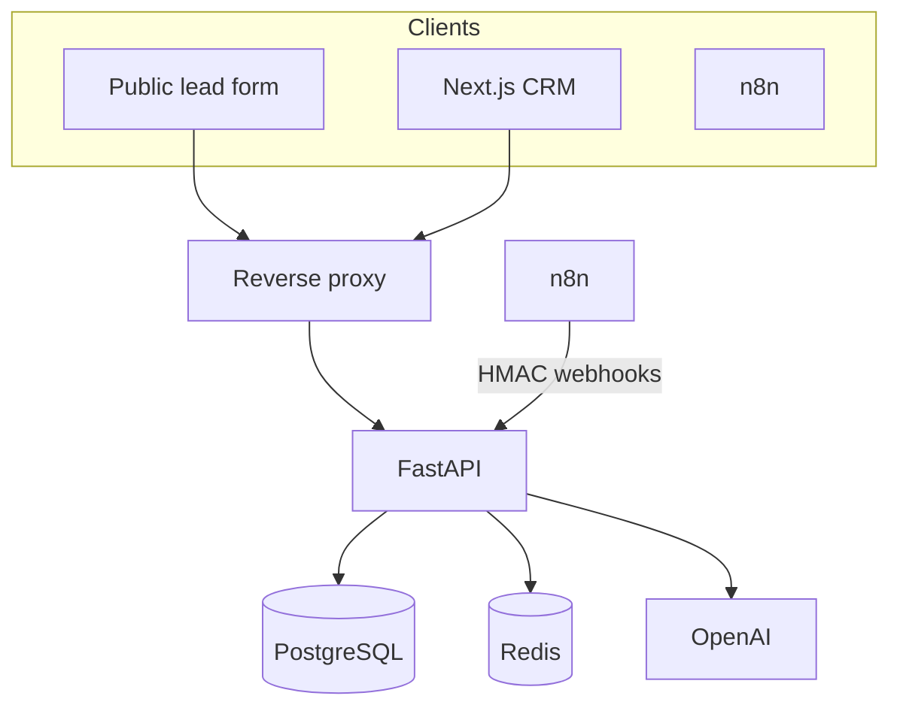

# Vyrenlo AI LeadFlow — Architecture (Phase 1)

See the product brief in the repository README. This document is the canonical architecture reference for Phases 2–9.

**Diagrams:** [architecture-diagram.md](architecture-diagram.md) · **Deploy:** [deployment.md](deployment.md) · **Demo:** [demo-script.md](demo-script.md)

## System overview

- **Source of truth:** PostgreSQL + FastAPI (`apps/api`).
- **Dashboard:** Next.js (`apps/web`, Phase 4).
- **Orchestration:** n8n (`automation/n8n`, Phase 6) calls internal webhooks; business rules stay in the API.
- **AI:** OpenAI structured JSON qualification (Phase 5).

## Multi-tenancy

Shared database, row-level `tenant_id` on all tenant-owned tables. JWT carries `tenant_id`, `user_id`, `role`. Public ingest uses hashed API keys scoped to one tenant.

**Roles:** `owner`, `admin`, `agent`, `viewer`.

## Domain tables

| Table | Purpose |
|-------|---------|
| `tenants` | Business account, vertical, timezone, settings JSONB |
| `users` | CRM users per tenant |
| `refresh_tokens` | Session rotation |
| `api_keys` | Public lead ingest (hash only) |
| `leads` | Core lead record + dedup_key unique per tenant |
| `lead_qualifications` | Versioned AI outputs |
| `tenant_ai_config` | Models, prompts, approval flags |
| `communications` | Email/WhatsApp/inbound/outbound + approval |
| `follow_ups` | Scheduled sequence steps |
| `automation_settings` | Intervals, business hours |
| `lead_notes` | Internal notes |
| `lead_events` | Audit + activity feed + idempotency |
| `workflow_runs` | n8n execution mirror |

### Lead status

`new` → `qualifying` → `qualified` → `contacted` → `engaged` → `won` | `lost` | `spam` | `opted_out`

### Priority

`hot`, `warm`, `cold`, `unqualified`

## API surface (`/v1`)

- Auth: login, refresh, logout
- CRM: leads CRUD, notes, qualify, communications, approve/send
- Public: `POST /v1/public/leads`
- Internal (n8n): signed webhooks with idempotency keys
- Analytics: overview, sources

## n8n workflows (Phase 6)

1. New Lead Capture  
2. AI Lead Qualification  
3. Lead Notification  
4. Automated Follow-up Scheduler  
5. Customer Response Detection  
6. Daily Sales Summary  
7. Failed Workflow Recovery  

## Security

JWT + refresh rotation, HMAC webhooks, Redis rate limits, Pydantic validation, no secrets in logs, Argon2 passwords.

## Phase roadmap

| Phase | Focus |
|-------|--------|
| 2 | Docker, DB, Alembic, health |
| 3 | Auth, leads API, public ingest |
| 4 | Next.js dashboard |
| 5 | AI qualification |
| 6 | n8n |
| 7 | Follow-ups + email |
| 8 | Tests + hardening |
| 9 | Deploy + demo data |

## Demo narrative

Form submit → dedup → qualify (Hot) → staff notify + draft email → approve → follow-up sequence → inbound reply pauses sequence → daily summary.